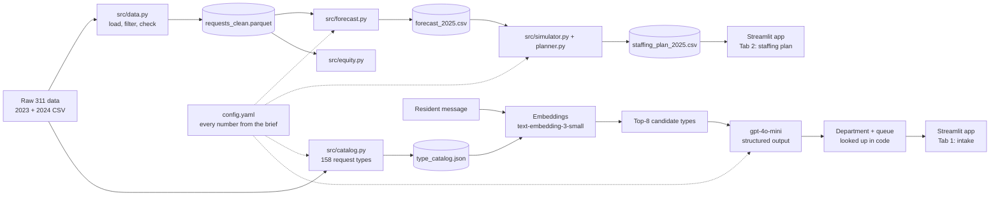
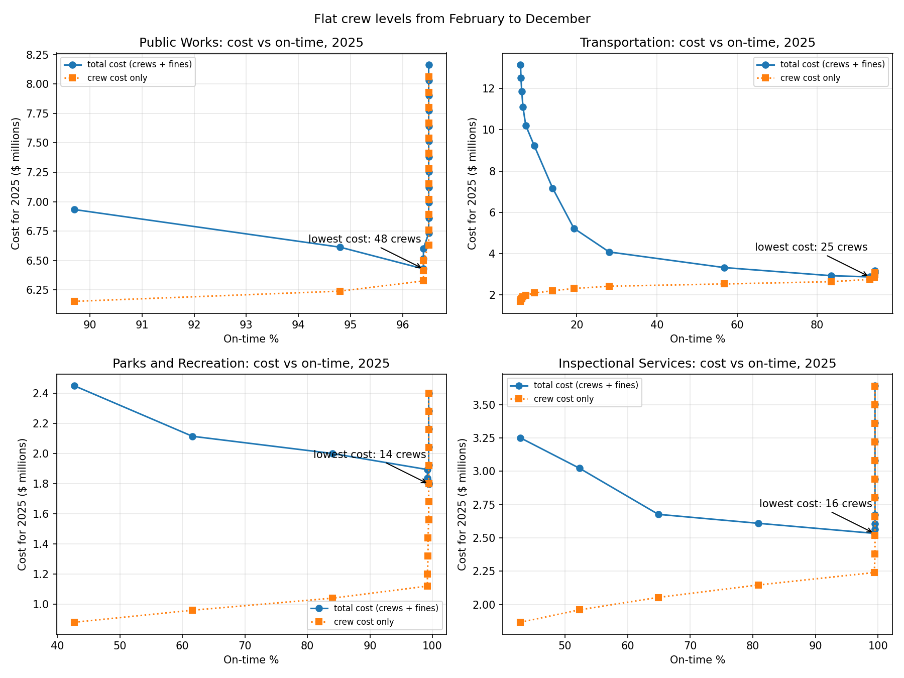
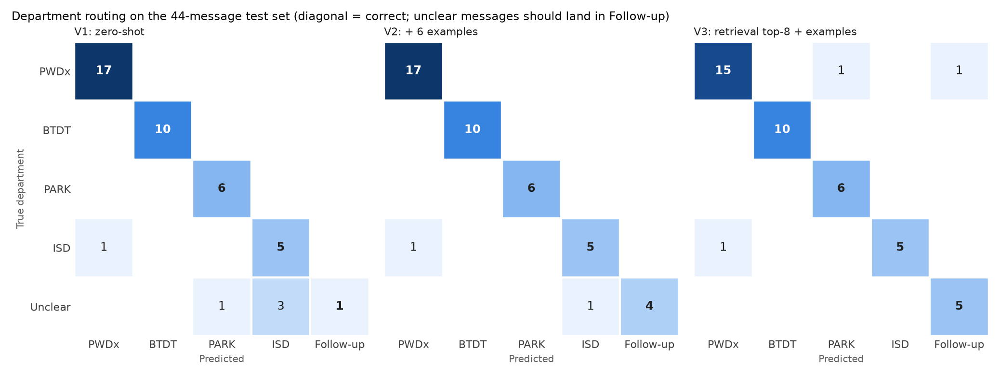

# Boston 311 Crew Staffing

IE 5374 Applied Generative AI, Module 7 Hackathon, Topic 2: *Staffing Boston's 311 City Service Teams*

Boston's 311 line takes hundreds of thousands of requests a year, from potholes to broken street
lights to landlords who won't fix the heat. For this project we worked out how many field crews
four city departments need in each month of 2025, and we built an intake assistant that reads a
resident's message and sends it to the right team.

The four departments are Public Works (PWDx), Transportation (BTDT), Parks and Recreation (PARK)
and Inspectional Services (ISD).

## What's in the repo

| Deliverable | Where to find it |
|---|---|
| GenAI app (API calls, prompt engineering, structured output, RAG) | `app/app.py`, `src/intake.py` |
| Month-by-month 2025 staffing plan | `data/processed/staffing_plan_2025.csv` (all five scenarios) |
| Analysis report | [`docs/Boston-311-Crew-Staffing-Analysis-Report-Team-2.pdf`](docs/Boston-311-Crew-Staffing-Analysis-Report-Team-2.pdf) |
| Notebook with every cell run | `notebooks/main.ipynb` |
| 3-minute demo video | *(TODO: link, check it opens while logged out)* |
| AI-use disclosure | [AI use](#ai-use) below and `docs/ai_use_log.md` |

## How it fits together



The data side (left to right along the top) cleans the two years of requests, forecasts 2025
demand and turns that into a crew plan. The intake side matches a message against the request
types and lets the model pick one. Both feed the Streamlit app. Every number from the brief lives
in `config.yaml` instead of being typed into the code.

We cache every model call in `data/cache/`, which means the notebook and the evaluation rerun
without an API key and give the same answer every time.

## Setup

You'll need Python 3.11 or newer (we used 3.13).

```bash
git clone https://github.com/kavin1317/Boston-311-Crew-Staffing---Hackathon.git
cd Boston-311-Crew-Staffing---Hackathon
python3 -m venv .venv
source .venv/bin/activate
pip install -r requirements.txt
cp .env.example .env
```

Add your OpenAI key to `.env`. You only need it to route messages the app hasn't seen before.

The two course data files are too big for the repo, so copy them into `data/raw/` yourself:

- `data/raw/lagan_311_open_data_2023_rvsd3.csv`
- `data/raw/lagan_311_open_data_2024_rvsd3.csv`

## Running it

Run these from the repo root, roughly in this order:

| Step | Command |
|---|---|
| Clean the data | `python -m src.data` |
| Forecast 2025 | `python -m src.forecast` |
| Build the request-type catalog | `python -m src.catalog routing`, then `python -m src.catalog` |
| Check retrieval | `python -m src.intake retrieval` |
| Try 5 messages end to end | `python -m src.intake demo` |
| Compare the three prompt versions | `python -m src.intake eval` |
| Draw the confusion matrices | `python -m src.intake errors` |
| Check the simulator against 2024 | `python -m src.planner calibrate` |
| Build the 2025 staffing plan | `python -m src.planner` |
| Run the sensitivity analysis | `python -m src.sensitivity` |
| Open the notebook | `jupyter notebook notebooks/main.ipynb` |
| Start the app | `streamlit run app/app.py` |

## What we found

### Demand forecast

The 2024 counts in our data match the brief exactly. Public Works is by far the busiest
department, and it is also the only one that shrank:

| Department | 2023 | 2024 | 2025 forecast | Backtest error |
|---|---|---|---|---|
| Public Works | 171,268 | 157,610 | 145,040 | 13.6% |
| Transportation | 75,314 | 81,447 | 88,078 | 7.6% |
| Parks and Recreation | 17,541 | 18,736 | 20,010 | 17.7% |
| Inspectional Services | 18,123 | 18,624 | 19,140 | 13.3% |

With only 24 months of history we kept the method simple: each month's usual share of the year,
times a 2025 total that continues the 2023-to-2024 trend. Parks is the hardest to predict because
its 2024 peak came in June instead of August. Public Works is the one to watch, since the
forecast assumes its drop keeps going.

### Staffing plan

Transportation is the department that needs help. It starts 2025 with 18 crews, which can't keep
up, so almost every request ends up late. Growing it to 25 crews by September lifts its on-time
rate from 7% to 93%, and it actually saves money, because the late fines were costing far more
than the extra crews ($10.2M down to $2.8M).

| Department | Crews | Hires / releases | On time in 2025 |
|---|---|---|---|
| Public Works | 50 in January, 48 from February | 0 / 2 | 96% |
| Transportation | 18 in January, 22 in February, 25 by September | 7 / 0 | 93% |
| Parks and Recreation | 10 in January, 12 in April, 15 from May | 5 / 0 | 99% |
| Inspectional Services | 16 all year | 0 / 0 | 99% |

The whole plan costs about $13.1M in crews and fines for 2025.

The plan is tight, though. With 20% more demand and no changes, Transportation drops to 2% on
time, and a severe February snowstorm leaves it with a backlog it still hasn't cleared by the
end of the year. Planning for the
storm ahead of time only takes about 1.4 extra Transportation crews, so we'd keep one or two
spare crews there going into winter. Transportation also can't get past about 94% on time at any
cost, since crews only work weekdays and a lot of its requests are due the next day.

We checked the simulator by running 2024's real demand through it. It comes out more optimistic
than reality for three departments and more pessimistic for Transportation, so we treat the plan
as the minimum staffing at the brief's crew capacity rather than a promise about service.
Sections 4 and 5 of the notebook have the full results.



### Intake assistant

To test it we wrote 44 messages the way residents actually write ("theres a huge pothole on
centre st by the T"), before running any model. 39 have a clear answer, and 5 are deliberately
vague, where the right move is to ask the resident a question.

We tried three prompt versions:

| Version | Department | Right type first | Right type in top 3 | Queue | Asks when unclear | Quiet when clear |
|---|---|---|---|---|---|---|
| V1: all 158 type names, no examples | 97% | 85% | 90% | 79% | 20% | 100% |
| V2: V1 plus 6 worked examples | 97% | 90% | 92% | 82% | 80% | 100% |
| V3: 8 retrieved types plus examples | 95% | 90% | 100% | 77% | 100% | 97% |

The worked examples mostly taught the model *when to ask*. Retrieval made sure the right answer
was always on the shortlist, so the app uses V3. The model only ever picks the request type; the
department and queue come from a lookup in our code, so it can't make those up.

Most of V3's mistakes were near-misses between similar types. The interesting ones came from the
catalog rather than the prompt: "Valet Parking Problems" (7 requests in 2024) beat "Parking
Enforcement" (63,064) because its description mentioned a blocked driveway. Queue accuracy is
lower because many queues are city districts, and a message usually doesn't say which district
it's in. More detail is in [`docs/intake_error_analysis.md`](docs/intake_error_analysis.md).



## Assumptions

The request data is real. Crew capacities, costs and starting crews come from the brief, and all
of them are in `config.yaml`.

- Every request counts as work, whatever its closure reason.
- A request that misses its target costs $20, and one still open 30 days after its target costs
  another $100. Each department's mix of targets comes from its 2024 requests
  (`data/processed/target_profile.csv`).
- The simulator spreads each month's demand evenly over its days. Crews work weekdays only and
  always take the most urgent request first.
- Where the brief is silent, we decided: crews are paid while training and during their notice
  month; requests with no target date count as on time (as they do in the data); seasonal Parks
  crews start in the month they're added and close 6 requests a day, like a full-time Parks crew.
- Requests still piled up on December 31 cost $120 each, so a plan can't look cheap by pushing
  work into the next year.
- 2023 and 2024 had mild winters, so the snowstorm (+50% in February for Public Works and
  Transportation) is an assumed bad storm. The heat wave (+40% in July for Parks and Inspectional
  Services) matches the worst summer week in the data, stretched over a month.
- For the intake assistant, each request type goes to the department and queue that handled it
  most often in 2024.

## Team

| Member | Role | Main work |
|---|---|---|
| Jogeashwini (A) | Data and forecasting | `src/data.py`, `src/forecast.py`, `src/equity.py`, the notebook, the first version of the type catalog |
| Kavin (B) | Intake assistant and app | `src/catalog.py`, `src/intake.py` (retrieval, structured output, prompt versions, evaluation, error analysis), the test set, `app/` |
| Chitra (C) | Staffing model | `src/simulator.py`, `src/planner.py`, `src/sensitivity.py`, the 2025 plan behind the app's staffing tab, notebook Sections 4 and 5 |

The commit history shows who did what.

## AI use

The intake assistant runs on OpenAI models: `gpt-4o-mini` wrote the one-line descriptions in the
request-type catalog and picks the request type for each message, and `text-embedding-3-small`
handles retrieval. Those outputs are cached in `data/cache/` and labelled as AI-generated in the
notebook.

We also used AI assistants while building the project. They helped write code, the test
messages, the error analysis, parts of the report, and the first drafts of this README's
architecture, results and assumptions sections, which we then reviewed and edited. Every use, and
what we checked or changed, is logged in [`docs/ai_use_log.md`](docs/ai_use_log.md).

One limitation follows from this: the same AI that wrote the catalog descriptions also helped
write the test messages, so the intake results are probably better than what real residents
would get.
