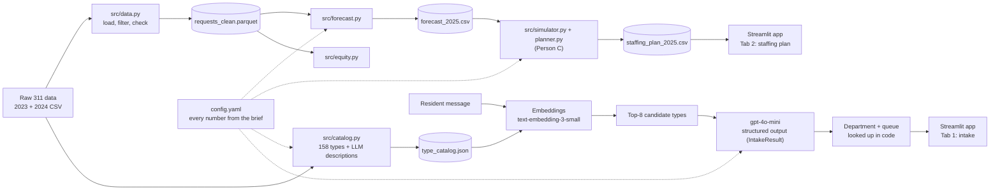

# Boston 311 Crew Staffing

IE 5374 Applied Generative AI · Module 7 Hackathon · Topic 2: *Staffing Boston's 311 City Service Teams*

We plan how many field crews four City of Boston departments need in each month of 2025, and
build a GenAI intake assistant that routes residents' 311 requests to the right team.

| Department | Code |
|---|---|
| Public Works | PWDx |
| Transportation | BTDT |
| Parks and Recreation | PARK |
| Inspectional Services | ISD |

> *Sections marked **[AI-drafted]** were first drafted with an AI assistant and then reviewed and
> edited by the team. See [AI use](#ai-use).*

## Deliverables

| # | Deliverable | Where |
|---|---|---|
| 1 | GenAI app (API calls, prompt engineering, structured output, RAG) | `app/app.py`, `src/intake.py` |
| 2 | Month-by-month 2025 staffing plan for 4 departments | `data/processed/staffing_plan_2025.csv` *(TODO: Person C)* |
| 3 | Analysis report: decisions, assumptions, sensitivity | *(TODO: link)* |
| 4 | This repo: code, setup, architecture, contributions | here |
| 5 | Jupyter notebook, all cells run with outputs | `notebooks/main.ipynb` |
| 6 | 3-minute demo video | *(TODO: link — check it opens while logged out)* |
| 7 | AI-use disclosure | [AI use](#ai-use), `docs/ai_use_log.md` |

## Architecture **[AI-drafted]**



Every LLM and embedding call is cached in `data/cache/`, so the notebook and the evaluation
rerun with **no API calls** and give the same result every time.

## Setup

Requires Python 3.11+ (developed on 3.13).

```bash
git clone https://github.com/kavin1317/Boston-311-Crew-Staffing---Hackathon.git
cd Boston-311-Crew-Staffing---Hackathon
python3 -m venv .venv
source .venv/bin/activate
pip install -r requirements.txt
cp .env.example .env        # then put your OpenAI key in .env (only needed for new messages)
```

Put the two course data files in `data/raw/` (they are not in the repo):

- `data/raw/lagan_311_open_data_2023_rvsd3.csv`
- `data/raw/lagan_311_open_data_2024_rvsd3.csv`

## How to run

| What | Command |
|---|---|
| Clean data (Person A) | `python -m src.data` |
| 2025 forecast (Person A) | `python -m src.forecast` |
| Request-type routing and catalog | `python -m src.catalog routing` then `python -m src.catalog` |
| Retrieval recall@k | `python -m src.intake retrieval` |
| 5 messages end to end | `python -m src.intake demo` |
| Compare prompt versions V1/V2/V3 | `python -m src.intake eval` |
| Confusion-matrix chart | `python -m src.intake errors` |
| Notebook | `jupyter notebook notebooks/main.ipynb` |
| App | `streamlit run app/app.py` |

The app's staffing tab reads `data/processed/staffing_plan_2025.csv`. Until that file exists it
shows a clearly labelled placeholder (`python -m app.placeholder_plan`): a do-nothing baseline,
not the staffing plan.

## Results

### Intake assistant **[AI-drafted]**

Test set: 44 resident-style messages written before any model run (`data/test_messages.csv`):
39 clear (17 PWDx, 10 BTDT, 6 PARK, 6 ISD; two with two problems) and 5 deliberately unclear.

Retrieval puts the true type in the top 8 for **100%** of clear messages (top 1: 56%, top 3: 85%).

| Version | Dept acc | Type top-1 | Type top-3 | Queue acc | Asks on unclear | Quiet on clear |
|---|---|---|---|---|---|---|
| V1 zero-shot, all 158 type names | 97% | 85% | 90% | 79% | 20% | 100% |
| V2 + 6 worked examples | 97% | 90% | 92% | 82% | 80% | 100% |
| **V3 top-8 retrieved + examples (app)** | 95% | 90% | **100%** | 77% | **100%** | 97% |

- Worked examples mostly teach *when to ask* (follow-up on unclear messages: 20% → 80%).
- Retrieval (V3) gets the right type into the top 3 every time and asks on every unclear message.
- The LLM only picks the type; **department and queue are looked up in code**, so they cannot be invented.
- V3's main weakness: rare look-alike types with similar AI-written descriptions (e.g. "Valet
  Parking Problems", 7 requests in 2024, beat "Parking Enforcement", 63,064). Details in
  [`docs/intake_error_analysis.md`](docs/intake_error_analysis.md).


### Demand forecast

See `notebooks/main.ipynb`, Section 2, and `docs/figures/forecast_2025.png`. *(TODO: Person A — key numbers.)*

### Staffing plan and sensitivity

*(TODO: Person C — crews by month, cost, on-time %, and the base / ±20% / snowstorm / heat-wave scenarios.)*

## Assumptions

Request data is real; capacities, costs and starting crews are the brief's assumed values, all in
`config.yaml`.

- Every request counts (no filtering by closure reason).
- On-time rule: a request not closed in the month it opens is overdue ($20); still open a month
  later is 30+ days past target (extra $100).
- *Brief is silent, our choice:* crews are paid during training and during notice months;
  seasonal Parks crews (April–October) start working in the month they are added; requests
  with no target date count as on time (as in the data). Seasonal crew capacity: *(TODO: Person C)*.
- Intake: request types come from 2024 data for the four departments (158 types). Each type's
  department and queue are its most common ones in 2024. Many queues are district queues that
  depend on the address, which a message often does not give, so queue accuracy is lower than
  department accuracy.

## Team and contributions

| Member | Role | Main work |
|---|---|---|
| Jogeashwini (A) | Data & forecasting | `src/data.py`, `src/forecast.py`, `src/equity.py`, `notebooks/main.ipynb`, first version of the type catalog |
| Kavin (B) | Intake assistant & app | `src/catalog.py` (routing + catalog revision), `src/intake.py` (retrieval, structured output, prompt versions, evaluation, error analysis), test set, `app/` |
| Chitra (C) | Staffing model | `src/simulator.py`, `src/planner.py`, sensitivity *(TODO)* |

Commit history shows each member's work.

## AI use

We used AI tools in two ways, and every meaningful use is logged with what the team reviewed or
changed in [`docs/ai_use_log.md`](docs/ai_use_log.md):

1. **Inside the product:** `gpt-4o-mini` writes the request-type descriptions in the catalog and
   picks the request type in the intake assistant; `text-embedding-3-small` does retrieval.
   These outputs are cached in `data/cache/` and marked as AI-generated in the notebook.
2. **As a coding assistant:** an AI coding assistant helped write code, the test messages, the
   error-analysis text and parts of this README. Those parts are marked **[AI-drafted]**.

Known limitation: the same AI wrote the test messages and the catalog descriptions, so the
intake results are probably better than real-world accuracy.
