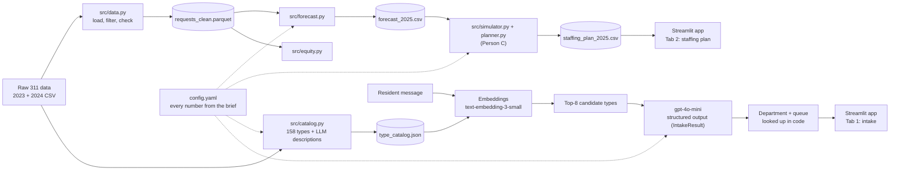

# Boston 311 Crew Staffing

IE 5374 Applied Generative AI · Module 7 Hackathon · Topic 2: *Staffing Boston's 311 City Service Teams*

We plan how many field crews four City of Boston departments need in each month of 2025, and
build a GenAI intake assistant that routes residents' 311 requests to the right team.

| Department | Code |
|---|---|
| Public Works | PWDx |
| Transportation | BTDT |
| Parks and Recreation | PARK |
| Inspectional Services | ISD |

> *Sections marked **[AI-drafted]** were first drafted with an AI assistant and then reviewed and
> edited by the team. See [AI use](#ai-use).*

## Deliverables

| # | Deliverable | Where |
|---|---|---|
| 1 | GenAI app (API calls, prompt engineering, structured output, RAG) | `app/app.py`, `src/intake.py` |
| 2 | Month-by-month 2025 staffing plan for 4 departments | `data/processed/staffing_plan_2025.csv` (all five scenarios) |
| 3 | Analysis report: decisions, assumptions, sensitivity | *(TODO: link)* |
| 4 | This repo: code, setup, architecture, contributions | here |
| 5 | Jupyter notebook, all cells run with outputs | `notebooks/main.ipynb` |
| 6 | 3-minute demo video | *(TODO: link — check it opens while logged out)* |
| 7 | AI-use disclosure | [AI use](#ai-use), `docs/ai_use_log.md` |

## Architecture **[AI-drafted]**



Every LLM and embedding call is cached in `data/cache/`, so the notebook and the evaluation
rerun with **no API calls** and give the same result every time.

## Setup

Requires Python 3.11+ (developed on 3.13).

```bash
git clone https://github.com/kavin1317/Boston-311-Crew-Staffing---Hackathon.git
cd Boston-311-Crew-Staffing---Hackathon
python3 -m venv .venv
source .venv/bin/activate
pip install -r requirements.txt
cp .env.example .env        # then put your OpenAI key in .env (only needed for new messages)
```

Put the two course data files in `data/raw/` (they are not in the repo):

- `data/raw/lagan_311_open_data_2023_rvsd3.csv`
- `data/raw/lagan_311_open_data_2024_rvsd3.csv`

## How to run

| What | Command |
|---|---|
| Clean data (Person A) | `python -m src.data` |
| 2025 forecast (Person A) | `python -m src.forecast` |
| Request-type routing and catalog | `python -m src.catalog routing` then `python -m src.catalog` |
| Retrieval recall@k | `python -m src.intake retrieval` |
| 5 messages end to end | `python -m src.intake demo` |
| Compare prompt versions V1/V2/V3 | `python -m src.intake eval` |
| Confusion-matrix chart | `python -m src.intake errors` |
| Notebook | `jupyter notebook notebooks/main.ipynb` |
| 2024 check: simulated vs actual on-time (Person C) | `python -m src.planner calibrate` |
| 2025 staffing plan, all scenarios (Person C) | `python -m src.planner` |
| Sensitivity and cost-vs-service curve (Person C) | `python -m src.sensitivity` |
| App | `streamlit run app/app.py` |

The app's staffing tab reads `data/processed/staffing_plan_2025.csv`. Until that file exists it
shows a clearly labelled placeholder (`python -m app.placeholder_plan`): a do-nothing baseline,
not the staffing plan.

## Results

### Intake assistant **[AI-drafted]**

Test set: 44 resident-style messages written before any model run (`data/test_messages.csv`):
39 clear (17 PWDx, 10 BTDT, 6 PARK, 6 ISD; two with two problems) and 5 deliberately unclear.

Retrieval puts the true type in the top 8 for **100%** of clear messages (top 1: 56%, top 3: 85%).

| Version | Dept acc | Type top-1 | Type top-3 | Queue acc | Asks on unclear | Quiet on clear |
|---|---|---|---|---|---|---|
| V1 zero-shot, all 158 type names | 97% | 85% | 90% | 79% | 20% | 100% |
| V2 + 6 worked examples | 97% | 90% | 92% | 82% | 80% | 100% |
| **V3 top-8 retrieved + examples (app)** | 95% | 90% | **100%** | 77% | **100%** | 97% |

- Worked examples mostly teach *when to ask* (follow-up on unclear messages: 20% → 80%).
- Retrieval (V3) gets the right type into the top 3 every time and asks on every unclear message.
- The LLM only picks the type; **department and queue are looked up in code**, so they cannot be invented.
- V3's main weakness: rare look-alike types with similar AI-written descriptions (e.g. "Valet
  Parking Problems", 7 requests in 2024, beat "Parking Enforcement", 63,064). Details in
  [`docs/intake_error_analysis.md`](docs/intake_error_analysis.md).


### Demand forecast

See `notebooks/main.ipynb`, Section 2, and `docs/figures/forecast_2025.png`. *(TODO: Person A — key numbers.)*

### Staffing plan and sensitivity **[AI-drafted]**

Base plan, active crews (January is fixed at the starting crews):

| Department | January | Plan | Hires / releases | On time, 2025 |
|-|-|-|-|-|
| Public Works | 50 | 48 from February | 0 / 2 | 96% |
| Transportation | 18 | 22 in February, rising to 25 by September | 7 / 0 | 93% |
| Parks and Recreation | 10 | 12 in April, 15 from May | 5 / 0 | 99% |
| Inspectional Services | 16 | 16 all year | 0 / 0 | 99% |

Cost of the base plan in 2025 (crews and fines): about $13.1M.

- **Understaffing is the expensive choice.** Keeping Transportation at 18 crews would cost about
  $10.2M, mostly fines, at 7% on time; the plan costs about $2.8M at 93%.
- **2024 check.** With January 2025 crews, the simulator gives 96 / 17 / 99 / 99.5% on time for
  PWDx / BTDT / PARK / ISD against 90 / 50 / 93 / 72% in 2024: optimistic for three departments,
  pessimistic for Transportation, where about 20% of 2024 requests were never closed. We keep the
  brief's capacities, so the plan is the minimum staffing at the brief's crew capacity.
- **The plan is lean.** With 20% more demand and no change to the plan, Transportation falls to 2%
  on time, Public Works to 57% and Inspectional Services to 52%. After the snowstorm, Transportation
  falls to 9% and its backlog is not cleared by December 31. Planned in advance, the storm needs
  only about 1.4 more Transportation crews on average ($3.1M instead of $4.3M), so we recommend
  one or two extra Transportation crews going into winter.
- **Transportation cannot reach 95% on time at any cost** (best about 94%): crews work weekdays
  only and many of its requests are due the next day.
- **Parks keeps full-time crews rather than seasonal ones**: most Parks requests have year-long
  targets, so work keeps arriving after October. This depends on our year-end charge.

Details: notebook Sections 4 and 5, `data/processed/sensitivity.csv`,
`data/processed/cost_curve_targets.csv`.


## Assumptions

Request data is real; capacities, costs and starting crews are the brief's assumed values, all in
`config.yaml`.

- Every request counts (no filtering by closure reason).
- Staffing simulator: each month's forecast is spread evenly over its days. Crews work on
  weekdays only (a month's capacity = crews x capacity per crew per day x 21, spread over its
  weekdays) and close the requests with the earliest target first. A request still open after
  its target costs $20; still open 30 days after its target, an extra $100. Days to target come
  from 2024 data for each department (`data/processed/target_profile.csv`).
- *Our choice:* requests left piled up on December 31 (beyond the last 14 days of arrivals, or
  already late) cost $120 each, so a plan cannot save money by letting work pile up after the
  year ends.
- *Our choice:* the snowstorm (+50% for February, PWDx and BTDT) is an assumed severe storm,
  because 2023 and 2024 winters were mild (worst month +7%, worst week +33%). The heat wave
  (+40% for July, PARK and ISD) matches the worst 2023-24 summer week, applied to a whole month.
- *Brief is silent, our choice:* crews are paid during training and during notice months;
  seasonal Parks crews (April–October) start working in the month they are added; requests
  with no target date count as on time (as in the data). Seasonal crews close as many requests a day as a full-time Parks crew (6).
- Intake: request types come from 2024 data for the four departments (158 types). Each type's
  department and queue are its most common ones in 2024. Many queues are district queues that
  depend on the address, which a message often does not give, so queue accuracy is lower than
  department accuracy.

## Team and contributions

| Member | Role | Main work |
|---|---|---|
| Jogeashwini (A) | Data & forecasting | `src/data.py`, `src/forecast.py`, `src/equity.py`, `notebooks/main.ipynb`, first version of the type catalog |
| Kavin (B) | Intake assistant & app | `src/catalog.py` (routing + catalog revision), `src/intake.py` (retrieval, structured output, prompt versions, evaluation, error analysis), test set, `app/` |
| Chitra (C) | Staffing model and sensitivity | `src/simulator.py` (day-by-day simulator), `src/planner.py` (local-search planner, 2025 plan for all five scenarios, 2024 check), `src/sensitivity.py` (±20%, snowstorm and heat-wave runs, storm and heat-wave sizing from 2023-24 data, cost-vs-service curve), `staffing_plan_2025.csv` behind the app's staffing tab, notebook Sections 4 and 5, README staffing results and assumptions |

Commit history shows each member's work.

## AI use

We used AI tools in two ways, and every meaningful use is logged with what the team reviewed or
changed in [`docs/ai_use_log.md`](docs/ai_use_log.md):

1. **Inside the product:** `gpt-4o-mini` writes the request-type descriptions in the catalog and
   picks the request type in the intake assistant; `text-embedding-3-small` does retrieval.
   These outputs are cached in `data/cache/` and marked as AI-generated in the notebook.
2. **As a coding assistant:** an AI coding assistant helped write code, the test messages, the
   error-analysis text and parts of this README. Those parts are marked **[AI-drafted]**.

Known limitation: the same AI wrote the test messages and the catalog descriptions, so the
intake results are probably better than real-world accuracy.
