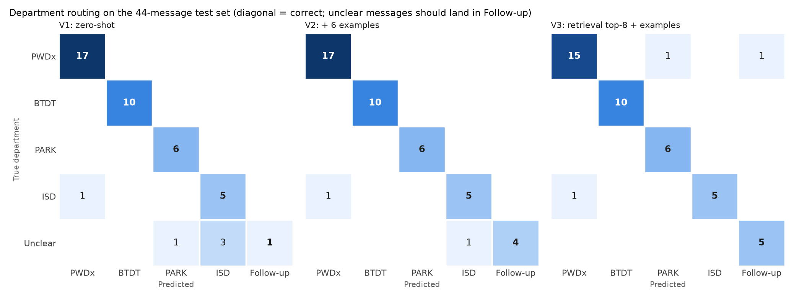

# Intake assistant — error analysis (Step 8)

Test set: 44 resident-style messages (39 clear, 5 deliberately unclear).
Full results: `data/processed/intake_eval.csv`; summary: `data/processed/intake_eval_summary.csv`.
Rebuild the chart with `python -m src.intake errors`.

| Version | Dept acc | Type top-1 | Type top-3 | Queue acc | Asks on unclear | Quiet on clear |
|---|---|---|---|---|---|---|
| V1 zero-shot, all type names | 97% | 85% | 90% | 79% | 20% | 100% |
| V2 + 6 worked examples | 97% | 90% | 92% | 82% | 80% | 100% |
| V3 top-8 retrieved + examples | 95% | 90% | 100% | 77% | 100% | 97% |

## The five worst mistakes (V3, the version the app uses)

| # | Message (shortened) | Expected → Predicted | Why it happened |
|---|---|---|---|
| 1 | "construction site next door starts banging at 5am every day" | Working Beyond Hours (ISD) → Work Hours-Loud Noise Complaints (**PWDx**) | Two types describe the same thing in two departments. The model's answer is reasonable; the city itself splits this by who runs the work. All three versions made this mistake. The right type is the first alternative. |
| 2 | "tons of spray paint tags all over the underpass wall on mass ave" | PWD Graffiti (PWDx) → Graffiti Removal (**PARK**, 12 requests in 2024) | Wrong department. The rare PARK type has a cleaner, more general description than "PWD Graffiti", so with descriptions shown (V3) it wins. V1 and V2 saw only names and got it right. |
| 3 | "somebody parked across my driveway on tremont again" | Parking Enforcement (63,064 requests) → Valet Parking Problems (7 requests) | The LLM-written description for Valet Parking says "blocking my driveway", which matches the message word for word. A catalog description error: the fix is in the catalog, not the prompt. |
| 4 | "moving out saturday and need to get rid of a mattress + box spring" | Mattress_Pickup → Schedule a Bulk Item Pickup | The bulk-pickup description lists mattresses as an example. Same department and similar work, so routing is barely affected; all three versions did this. |
| 5 | "pothole right outside 12 boylston st, and the streetlight right above it is out too" | Pothole Repair, correct, but asked an unneeded follow-up question | A two-problem message. V3 put the street light first in the alternatives, as asked, but also asked a follow-up; V1 and V2 did not. The worked example for two problems was not enough. |

## Paragraph for the report

All three prompt versions route clear messages to the right department 95–97% of the
time; the difference between them is in the request type and in when they ask a
follow-up question. The few-shot examples mostly teach behaviour: going from V1 to V2
raised "asks a follow-up on unclear messages" from 20% to 80%. Retrieval (V3) puts
the right type in the top 3 for every clear message and asks a follow-up on all five
unclear ones, so the app uses V3. V3's main weakness is that, with descriptions shown,
it sometimes prefers a rare look-alike type over a common one: "Valet Parking
Problems" (7 requests in 2024) over "Parking Enforcement" (63,064), and PARK's
"Graffiti Removal" (12) over PWDx's "PWD Graffiti" (1,036). Three of its four wrong-type
answers trace back to the LLM-written catalog descriptions, not to the intake prompt,
which shows why the catalog needs human review. Possible fixes (not done): correct
those descriptions, or show each candidate's 2024 request count so the model can
prefer common types. Queue accuracy is lower (77–82%) because many types are routed
to a district queue that depends on the address. Limits: the test set is small (44
messages), and the same AI wrote both the test messages and the catalog
descriptions, so real-world accuracy is probably lower.
